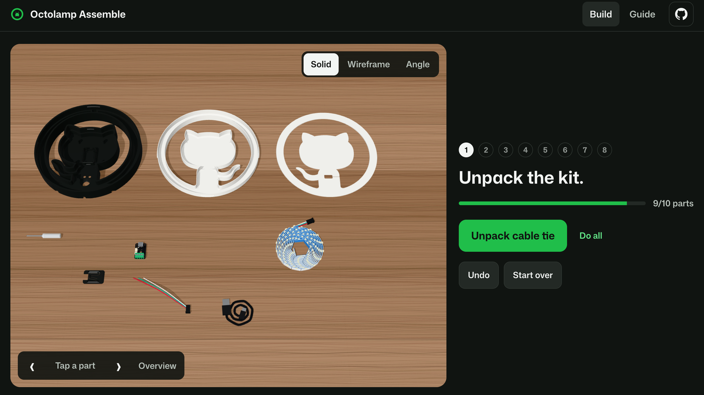
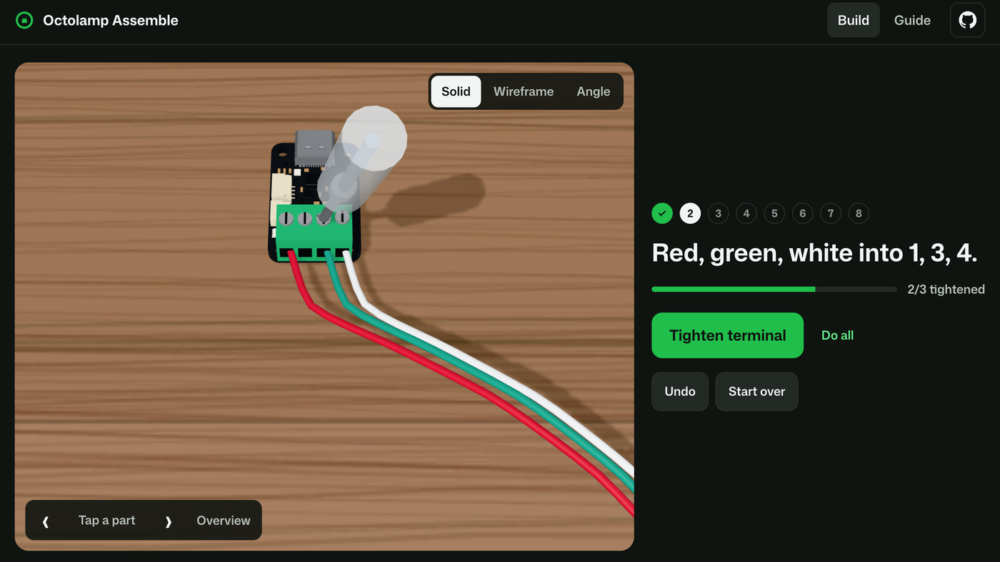
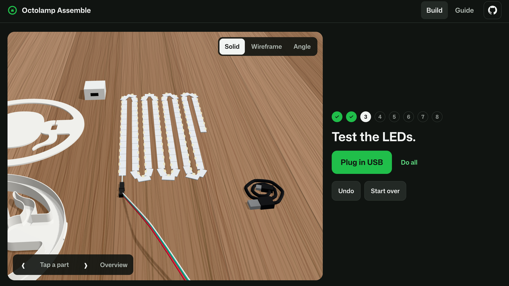
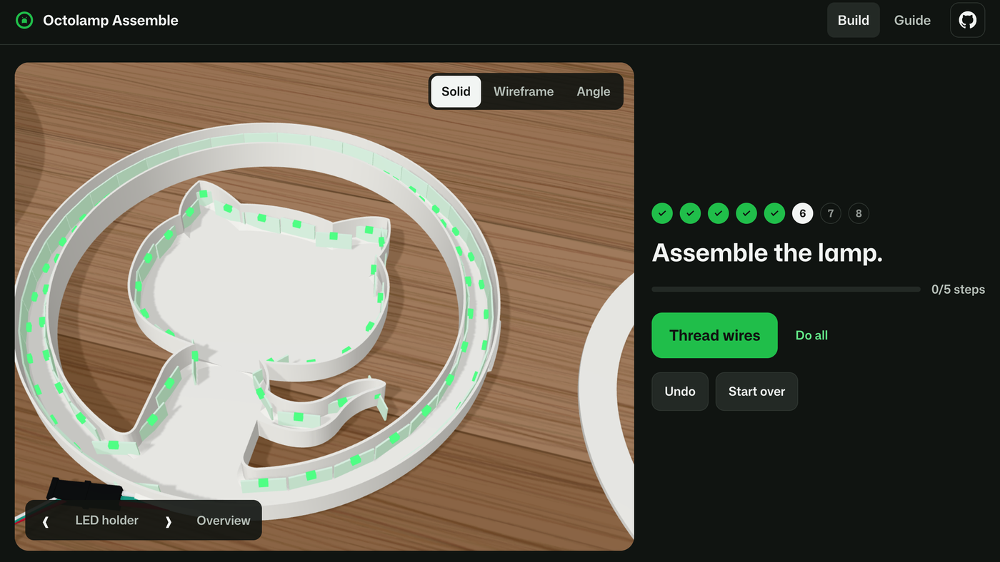
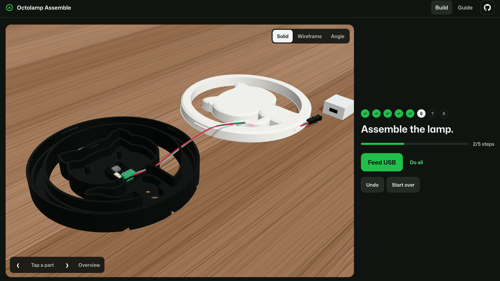
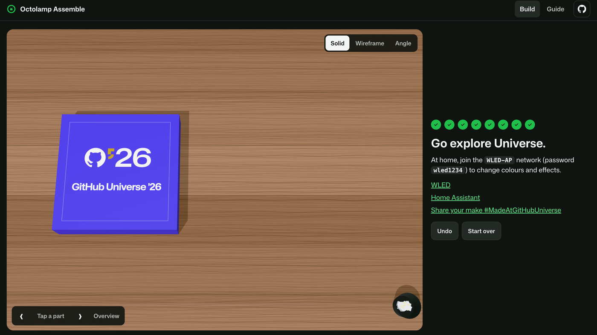

# Octolamp Assemble

An interactive 3D build of the Universe '26 Octolamp kit, following the [assembly guide](https://github.com/martinwoodward/octolamp/blob/main/UNIVERSE_ASSEMBLY.md).

## Run

```sh
npm install
npm run dev -- --port 4175
```

Open `http://127.0.0.1:4175`.

```sh
npm test
npm run build
npx playwright install chromium
npm run test:e2e
```

## What it does

1. **Unpack your kit.** Take the ten parts out onto the desk.

   
2. **Wire the board.** Loosen terminals 1, 3 and 4, insert the red, green and white wires, tighten.

   
3. **Test the LEDs.** Uncoil the strip, connect it, plug in USB.

   
4. **Stick the strip.** Outer ring first, then the inner ring and Mona. Cut off the excess and check it glows green.

   
5. **Assemble.** Thread the wires through the reflector, seat the board, feed the USB cable, snap the cover, press together.

   
6. **Final test and clean up.** Check it glows green, tidy the desk, pack the lamp.

   

Orbit, zoom and pan the desk, tap any part to focus it, and switch between Solid, Wireframe and Angle views. Every action can be undone and your build is saved in the browser.

## Links

[Walkthrough video](https://youtu.be/Ya8gMkDxdD4) · [Octolamp](https://github.com/martinwoodward/octolamp)

## Credits

Printed-part models and kit from [Octolamp](https://github.com/martinwoodward/octolamp) by Martin Woodward (CC BY-NC 4.0). Board model from [Adafruit](https://github.com/adafruit/Adafruit_CAD_Parts) (MIT). GitHub logos and the Universe '26 lockup are GitHub's.
